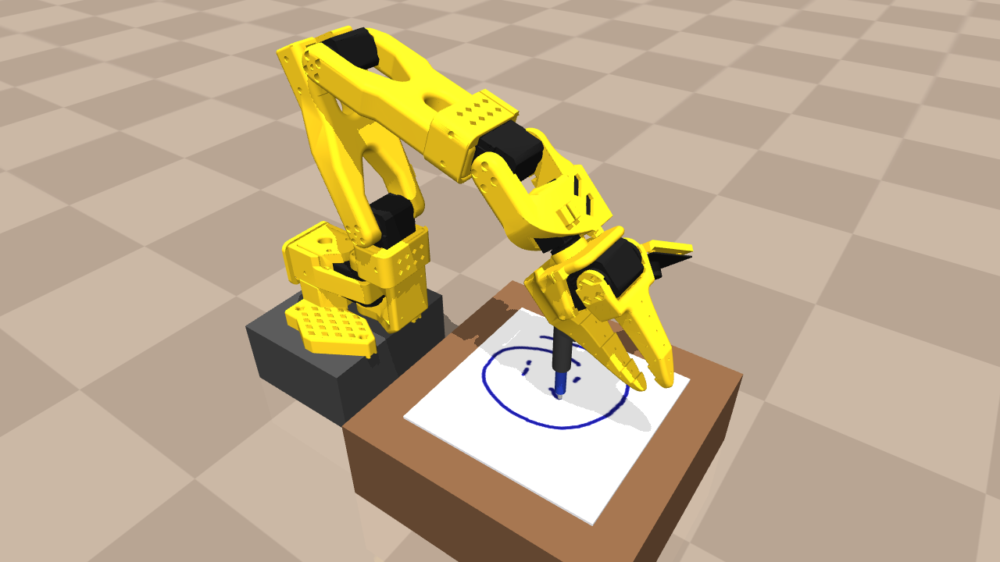
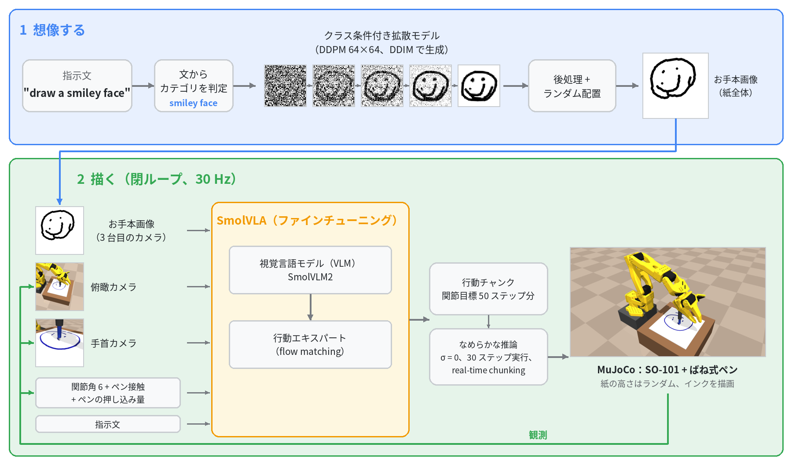
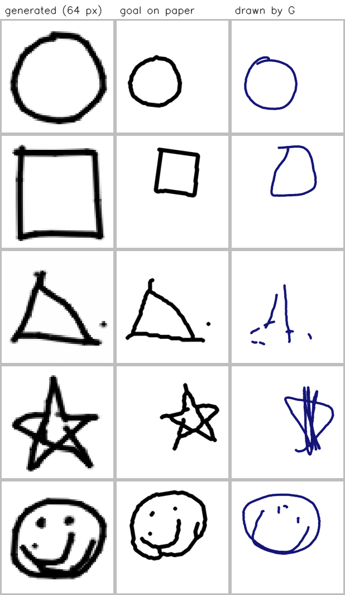
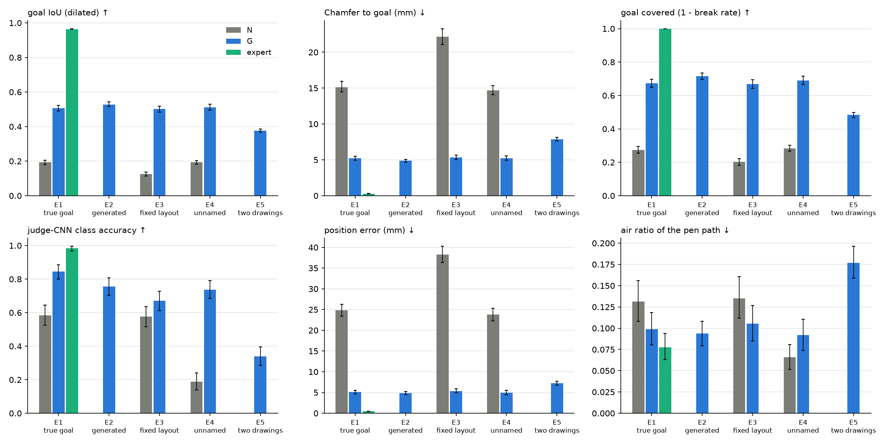

# お絵かきVLA (Oekaki VLA) — 絵を想像して、ロボットがペンで描く

[English README](README.md)



**ばね式ペン**を持ったシミュレーション上の SO-101 アームが、`"draw a star"` のような言語指示から紙に絵を描きます。
まず小さな拡散モデルが線画を「想像」します。その線画を紙の上に配置し、お手本画像（3 台目のカメラ）として
**SmolVLA** に見せます。SmolVLA はペンでその絵を写して描きます。

すべて MuJoCo 上で動きます。Physical AI 応用編 1（2026）の最終課題として作りました。



1. **想像する：** 指示文からカテゴリを読み取る。クラス条件付き拡散モデルが 64×64 の線画を描き、後処理のあと
   紙の上のランダムな位置・大きさ・角度に配置する。これがお手本画像になる。
2. **描く：** 30 Hz で、SmolVLA がお手本画像、俯瞰・手首カメラ、関節角とペンの接触・押し込み量、指示文を受け取り、
   関節目標 50 ステップ分の行動チャンクを出す。なめらかな推論（σ = 0、1 チャンクにつき 30 ステップ実行、
   real-time chunking）で実行する。

## ハイライト

**お手本画像があると、VLA は頼まれた絵を、頼まれた場所に描く。**
- 設定：同じデータ・同じ学習レシピで SmolVLA を 2 つ学習した。
  - **G** はお手本画像を見る。
  - **N** は指示文だけを見る。
- テスト：学習に使っていない Quick, Draw! の絵で、設定ごとに対応付きの 250 エピソード。

| 設定 | G（お手本画像あり） | N（文のみ） |
|---|---|---|
| お手本との IoU（本物のお手本） | **0.51** | 0.19 |
| 位置のずれ（本物のお手本） | **5.1 mm** | 24.9 mm |
| お手本との IoU（拡散モデルが想像したお手本） | **0.53** | — |
| お手本との IoU（カテゴリ名を含まない指示） | **0.51** | 0.19 |

- 対応付きエピソードの 96 % で G が上回った（Wilcoxon p < 1e-40）。
- カテゴリ名がなくても G の成績は変わらない。つまり G は「何を描くか」を画像から読んでいる。
- 生成モデルは 1000 サンプル中、空の画像を 1 枚も出さなかった。判定 CNN は生成された絵の 99.9 % を正しく認識する。

**flow matching の VLA でなめらかに描く。**
- そのままの SmolVLA では腕が震え、線がギザギザになる。
- 対策：
  - flow の初期ノイズを 0 にする。
  - 実行ホライズンを長くする（50 ステップのチャンクのうち 30 ステップを実行）。
  - チャンクのつなぎ目を real-time chunking（RTC）でならす。
- 結果：品質成功率が 2 % から 54 % に上がり、jerk は約 160 分の 1 になった。

**接触入力についての負の結果。** 関節角の状態にペンの接触情報を加えても、成功率に有意な差は出なかった
（82 % 対 76 %、McNemar p = 0.63）。手首カメラにペンの押し込みがすでに写っているためと考えられる。

## 目次
- [セットアップ](#セットアップ)
- [Hugging Face のモデルとデータ](#hugging-face-のモデルとデータ)
- [リポジトリの構成](#リポジトリの構成)
- [シミュレーション・エキスパート・データ](#シミュレーションエキスパートデータ)
- [想像してから描く](#想像してから描く)
- [なめらかに描く](#なめらかに描く)
- [接触は役に立つか](#接触は役に立つか)
- [クラウド GPU で回す](#クラウド-gpu-で回す)
- [ライセンスと出典](#ライセンスと出典)

## セットアップ

```bash
uv venv --python 3.12 && uv sync                       # lerobot[smolvla] 0.6.1, mujoco 3.x, torch
export MUJOCO_GL=egl                                   # GPU でのヘッドレス描画
env -u PYTHONPATH .venv/bin/python -m pytest -q tests  # ROS 環境などで PYTHONPATH が設定されている場合は外す
```

- リポジトリにはデータセット・チェックポイント・重みを含めていません。スクリプトが `data/` と `outputs/` に書き出します。
  学習済みモデルと主なデータセットは Hugging Face Hub にあります（次の節）。
- 乱数シードは `configs/` で固定しています。

## Hugging Face のモデルとデータ

| | リポジトリ | 中身 |
|---|---|---|
| モデル | [tkb77/smolvla-oekaki-goal](https://huggingface.co/tkb77/smolvla-oekaki-goal) | SmolVLA のモデル G（お手本画像を見る） |
| モデル | [tkb77/oekaki-sketch-diffusion](https://huggingface.co/tkb77/oekaki-sketch-diffusion) | 線画を生成する拡散モデル |
| データセット | [tkb77/oekaki-goal-v1](https://huggingface.co/datasets/tkb77/oekaki-goal-v1) | データセット goal_v1：エキスパートの 999 エピソード、LeRobot v3.0 形式 |

`--policy` と `--generator` には Hub のリポジトリ名も指定でき、初回にダウンロードされます。学習なしで描かせるには：

```bash
.venv/bin/python scripts/imagine_and_draw.py --prompt "draw a star" --seed 1 --out outputs/demo_star \
    --policy tkb77/smolvla-oekaki-goal --generator tkb77/oekaki-sketch-diffusion
```

カードは `docs/hub/` にあり、`scripts/upload_to_hub.py` がそれを付けてモデルとデータセットをアップロードします。

## リポジトリの構成

```
oekaki/env/          シーン構築（MjSpec）と DrawingEnv：ばね式ペン、接触スイッチ、インクのテクスチャ
oekaki/expert/       IK と接触駆動のエキスパート（ペンの押し込みから紙の高さを推定）
oekaki/data/         エキスパートのロールアウト -> LeRobotDataset、お手本画像つきエピソード（配置、お手本、2 つの絵）
oekaki/render.py     共通の線画レンダラ（生成モデルの学習データ、お手本画像、評価）
oekaki/quickdraw/    Quick, Draw! のダウンロード、絞り込み、train / test 分割
oekaki/layout.py     紙の上での絵のランダム配置
oekaki/generator/    クラス条件付き DDPM：モデル、サンプリング、後処理、「想像」API
oekaki/classifier/   判定 CNN
oekaki/policy/       SmolVLA の拡張：学習時 RTC、経過時間の入力、Hermite ヘッド
oekaki/eval/         評価指標（お手本 IoU、Chamfer、jerk など）とポリシーのラッパ（RTC 推論）
configs/             環境、データ生成、学習、評価の設定
scripts/             データ生成、学習、評価、集計、動画、デモ（下記）
docker/              クラウド GPU ノード用の学習・評価イメージ
docs/                クラウドでの学習手順（日本語）、README の画像、Hugging Face のカード
results/goal/        お手本画像の実験の確認画像と表
third_party/         流用した生成モデルコードの参照用コピー（Apache-2.0）
assets/so101/        MuJoCo Menagerie の SO-101 モデル（Apache-2.0）
```

## シミュレーション・エキスパート・データ

- **ロボット：** MuJoCo Menagerie の SO-101（5 自由度＋グリッパ）。
  - ペンホルダをグリッパに 42° 傾けて取り付け、15 cm 角の紙全体でペンを鉛直に立てられるようにした。
  - ペンはホルダ内をスライドする（可動 0〜10 mm、ばね 300 N/m）。
  - `接触 = 押し込み > 0.5 mm`。押し込み量も観測に入る。
- **紙：** エピソードごとに高さをランダムにし（±20 mm）、描画中に紙が動くエピソードもある。
- **インク：** 物理のサブステップごとに、ペン先と紙の接触から 512×512 のテクスチャを更新する。描いた線は
  カメラ画像にも写る。
- **カメラ：** 俯瞰と手首、256 px。
- **エキスパート：** 紙の本当の高さは参照しない。
  - ペンの押し込みから高さを推定する。
  - 接触しているときだけストロークを進め、接触が切れたら下方向に探す。
  - 点はペンを軽く当てて描く。
  - DART 型の高さノイズを実行する行動に加え、記録するのはノイズなしの行動にする。

## 想像してから描く

### しくみ

| 部品 | ファイル | 説明 |
|---|---|---|
| 共通レンダラ | `oekaki/render.py` | すべての線画を 1 つの関数で描く（線幅 = サイズ / 32、点は円）。生成画像とロボットが描いた紙は、細線化してから描き直してそろえる。 |
| Quick, Draw! | `scripts/download_quickdraw.py`, `configs/quickdraw.yaml` | circle, square, triangle, star, smiley face。認識済みで 8 ストローク以下の絵。test 分割（`key_id` で分ける）は評価にだけ使う。 |
| 配置 | `oekaki/layout.py`, `configs/layout.yaml` | 大きさ（描ける範囲の 40〜90 %）、回転（±15°）、左右反転をランダムにする。エキスパートの軌道とお手本画像を同じアフィン変換で動かす。 |
| データセット goal_v1 | `scripts/generate_goal_dataset.py`, `configs/datagen_goal_v1.yaml` | 999 エピソード、42 万フレーム。`observation.images.goal` が 3 本目の動画ストリーム。指示文の 30 % はカテゴリ名を含まない。 |
| 生成モデル | `scripts/train_generator.py`, `configs/generator.yaml` | DDPM、500 万パラメータ、classifier-free guidance、EMA、途中画像つきの DDIM。lcccluck/sketch-model を改変（NOTICE 参照）。 |
| 判定 CNN | `scripts/train_classifier.py` | 5 クラス分類。テスト正解率 99.1 %。 |
| SmolVLA G / N | `configs/train_goal_{G,N}.yaml`, `scripts/train_smolvla.py` | 15k ステップ、実効 batch 64、学習時 RTC と経過時間。N はお手本カメラを除く。 |
| 事前確認 | `configs/train_goal_overfit_G.yaml`, `scripts/eval_goal_overfit.py` | G を 30 エピソードで過学習させ、元のお手本と差し替えたお手本で評価する。 |
| 評価 | `scripts/evaluate_goal.py`, `configs/eval_goal.yaml`, `scripts/report_goal.py` | 設定 E1〜E5。bootstrap 信頼区間、画像グリッド、失敗の分類。 |
| デモ | `scripts/imagine_and_draw.py` | 指示 → 拡散のアニメーション → ロボットの描画 → お手本と結果を並べた動画。 |
| README の図 | `scripts/make_readme_figures.py` | 冒頭の写真とシステム図。モデル G の実際の 1 エピソードから作る。 |

```bash
.venv/bin/python scripts/download_quickdraw.py                  # データと一覧画像
.venv/bin/python scripts/generate_goal_dataset.py               # データセット goal_v1 -> data/goal_v1/G
bash scripts/goal_pipeline.sh classifier                       # 判定 CNN
bash scripts/goal_pipeline.sh generator                        # 拡散モデル
bash scripts/goal_pipeline.sh G; bash scripts/goal_pipeline.sh N
.venv/bin/python scripts/evaluate_goal.py --agent G=outputs/train/goal_G/checkpoints/last \
    --agent N=outputs/train/goal_N/checkpoints/last --agent expert=expert --settings E1 E2 E3 E4 E5
.venv/bin/python scripts/report_goal.py                         # -> results/goal/eval
.venv/bin/python scripts/imagine_and_draw.py --prompt "draw a star" --seed 1 --out outputs/demo_star
```

### 例



### 結果
設定：
- カテゴリ・設定ごとに 50 エピソード（設定ごとに 250）。
- お手本は学習に使っていない test 分割から取る。
- G、N、エキスパートは同じエピソードを走る。
- 推論：σ = 0、30 ステップごとに作り直し、遅延 3、推論時 RTC。
- 角括弧は bootstrap 95 % 信頼区間。表の全体は `results/goal/eval/`。

| 設定 | モデル | お手本 IoU ↑ | 位置のずれ (mm) ↓ | 判定 CNN の正解率 ↑ |
|---|---|---|---|---|
| E1 本物のお手本 | G | **0.51** [0.49, 0.52] | **5.1** | **0.84** |
| E1 本物のお手本 | N | 0.19 [0.18, 0.21] | 24.9 | 0.58 |
| E1 本物のお手本 | エキスパート | 0.97 | 0.5 | 0.98 |
| E2 生成したお手本 | G | 0.53 [0.52, 0.54] | 4.8 | 0.76 |
| E3 固定配置 | G / N | 0.50 / 0.13 | 5.4 / 38.3 | 0.67 / 0.58 |
| E4 カテゴリ名なし | G / N | 0.51 / 0.19 | 5.0 / 23.8 | 0.74 / 0.19 |
| E5 2 つの絵を並べる | G | 0.38 | 7.2 | — |



- **事前確認：** 30 エピソードで学習した G は、元のお手本は写せる（IoU 0.60）が、差し替えたお手本は写せない（0.21）。
  949 エピソードで学習すると、見たことのない test のお手本にも汎化する。
- **失敗**の多くは形の崩れ：星の細い先、スマイルの目、カテゴリの典型的な形から遠いお手本。
- **E5：** 2 つの絵が 1 つの形にまとまってしまう。学習データは 1 枚に絵が 1 つだけだった。

### 追加実験：データを増やす・2 つの絵のエピソード
- データセット goal_v2（`configs/datagen_goal_v2.yaml`）は、1 つの絵 2000 エピソードと 2 つの絵 500 エピソード。
- データまたはステップ数以外は G と同じレシピ。差は同じエピソードどうしで G と対応付けて調べた（Wilcoxon）。

| モデル | 学習データ | E1 IoU | E2 IoU | E5 IoU |
|---|---|---|---|---|
| G | goal_v1、1 つの絵 999 | 0.507 | 0.528 | 0.376 |
| G_2x | goal_v2、1 つの絵 1997 | **0.530** (p = 0.007) | **0.551** (p = 0.002) | 0.383 |
| G_pair | goal_v2、1 つの絵 1000 + 2 つの絵 496 | 0.500（差なし） | 0.509 | **0.523** (p < 1e-34) |
| G_long | goal_v1、1 つの絵 999、30k ステップ | **0.561** (p < 1e-10) | **0.580** (p < 1e-11) | 0.390 |

- 形の細部には、学習を 2 倍に延ばすのがいちばん効いた（IoU +0.05）。データを 2 倍にすると +0.02。どちらも有意。
- 2 つの絵のエピソードで学習すると、2 か所に別々の形を描けるようになり、E5 の IoU は 1 つの絵と同じ水準まで上がる。
- ただし、それぞれの半分の形が正しい割合は上がらない。左右の半分を判定 CNN にかけた結果：

  | モデル | 半分の形が正しい割合 |
  |---|---|
  | G | 0.33 |
  | G_2x | 0.39 |
  | G_long | 0.39 |
  | G_pair | 0.31 |

  詳細は `results/goal/eval/e5_halves.md` と `e5_G_vs_G_pair.png`。

## なめらかに描く

- **モデル：** 条件 A のデータ、10k ステップ。
- **学習時の拡張**（`oekaki/policy/smolvla_plus.py`, `configs/train_smooth_*.yaml`）：
  - 学習時 RTC：トークンごとの flow 時刻と、d ≤ 6 行動のノイズなしの先頭部分。
  - Hermite 曲線の補助ヘッド。
  - 経過時間の入力。
- **推論方式**（`oekaki/eval/policy.py`）：temporal ensembling、チャンク実行、推論時 RTC、TT-RTC。
  どれも遅延をシミュレートし、初期ノイズ σ を設定できる。

| モデル / 推論 | 品質 std | 品質 dist | Chamfer std (mm) | jerk std |
|---|---|---|---|---|
| エキスパート | 1.00 | 1.00 | 0.65 | 3.7k |
| そのまま：チャンク σ=1、5 ステップごと | 0.02 | 0.02 | 4.92 | 642k |
| temporal ensembling σ=1 | 0.12 | 0.10 | 3.72 | 138k |
| σ=0、30 ステップごと、遅延 3、推論時 RTC | 0.50 | 0.24 | 2.42 | 3.9k |
| + 学習時 RTC + 経過時間（最終形） | **0.54** | 0.28 | **2.25** | 4.1k |
| + Hermite 補助損失 λ=10 | 0.24 | 0.12 | 3.22 | 5.1k |

品質成功 = 認識できる ∧ 空中移動が 10 % 未満 ∧ インク量がエキスパートの 0.6〜1.4 倍 ∧ Chamfer ≤ 2 mm。
各条件は通常 50 エピソードと外乱あり 50 エピソード（std = 通常、dist = 外乱あり）。

1. **震えの原因はチャンクのつなぎ目ではなく、各チャンク内のサンプリングノイズ。** 予測チャンクの jerk は
   σ を 1 から 0 にすると 516k から 1.7k に下がる。
2. **σ=0 なら、実行ホライズンは長いほうがよい。** 品質は 5 ステップごとの 0.18 から、30 ステップごとの 0.48 に上がる。
3. **RTC は 3 ステップの遅延のもとでつなぎ目の跳びを消す。**
4. **学習時の拡張の効果は小さい。** 最終形は 0.41、同じモデルで推論時 RTC だけのものは 0.37（p = 0.42）。

コマンド：`scripts/run_smooth_eval.sh`, `scripts/report_smooth.py`, `scripts/render_smooth_videos.sh`。

## 接触は役に立つか

| 条件 | `observation.state` |
|---|---|
| **A** | 関節角 6 + 接触フラグ + ペンの押し込み量（8 次元） |
| **B** | 関節角 6（6 次元） |

- データ：エキスパートの 500 エピソード、16.2 万フレーム。
- 学習：条件ごとに 20k ステップ。
- 評価：対応付きエピソード。成功 = CLIP が形を認識 ∧ 経路のうち空中が 10 % 未満。

| 条件 | n | A | B | エキスパート | A 対 B（McNemar） |
|---|---|---|---|---|---|
| 通常 | 50 | 0.82 | 0.76 | 1.00 | p = 0.63 |
| 描画中に紙が動く | 50 | 0.56 | 0.54 | 0.96 | p = 1.00 |
| 紙の高さが学習範囲外（紙は見える） | 14 | 0.79 | 0.57 | 1.00 | p = 0.38 |

- 通常のエピソードでは、A のほうが接触を失う割合が小さい（空中率 0.029 対 0.062、p = 0.04）。
- 成功率の差はどれも有意ではない。手首カメラにペンの押し込みが写るので、B も画像から接触を読める。

```bash
.venv/bin/python scripts/test_pen_spring.py                  # ばね式ペンの確認
.venv/bin/python scripts/validate_expert.py --n 15           # エキスパートの確認
.venv/bin/python scripts/generate_dataset.py --name touch    # data/touch/{A,B}
bash scripts/train.sh                                        # SmolVLA A、続いて B
.venv/bin/python scripts/evaluate.py --agent A=outputs/train/A/checkpoints/last \
    --agent B=outputs/train/B/checkpoints/last --agent expert=expert --episodes-per-shape 10
.venv/bin/python scripts/make_report.py --eval artifacts/eval/results_A_B_expert.json
```

## クラウド GPU で回す

お手本画像まわりの学習と評価は、AWS g6e.24xlarge（NVIDIA L40S × 4）で GPU 1 枚につき 1 つずつ回した。

| 実行 | 時間 |
|---|---|
| 生成モデル + 判定 CNN | 4.0 時間 |
| G | 3.9 時間 |
| N | 2.7 時間 |
| 評価 2000 エピソード（25 プロセス） | 31 分 |

- `docker/Dockerfile.train` で環境を作る：CUDA 12.8 版の torch、FFmpeg、MuJoCo 用の EGL、AWS CLI、
  SmolVLA のベース重み。
- `scripts/cloud_task.sh`（学習）と `scripts/cloud_eval_goal.sh`（分割評価）は、コードとデータをオブジェクトストレージ
  から取り、結果を 10〜15 分ごとに書き戻す。
- 詳細：`docs/cloud_training.md`。

## ライセンスと出典

このリポジトリのコードは [Apache License 2.0](LICENSE) で公開しています。[NOTICE](NOTICE) も参照してください。

| もの | 出典 | ライセンス | 使い方 |
|---|---|---|---|
| SO-101 モデル | MuJoCo Menagerie `robotstudio_so101` | Apache-2.0、`assets/so101/LICENSE` | 同梱 |
| 拡散モデルのコード | [lcccluck/sketch-model](https://huggingface.co/lcccluck/sketch-model) | Apache-2.0 | 改変して使用。重みは一から学習 |
| 絵のデータ | [Quick, Draw! dataset](https://github.com/googlecreativelab/quickdraw-dataset)、Google Creative Lab | CC BY 4.0 | ダウンロードして使用。再配布はしない |
| VLA | SmolVLA / LeRobot、Hugging Face | Apache-2.0 | ベースモデルと学習基盤 |
| シミュレータ | MuJoCo | Apache-2.0 | シミュレーション |

実装・実験・ドキュメントは、AI コーディングアシスタント（Claude）の助けを借りて作りました。
