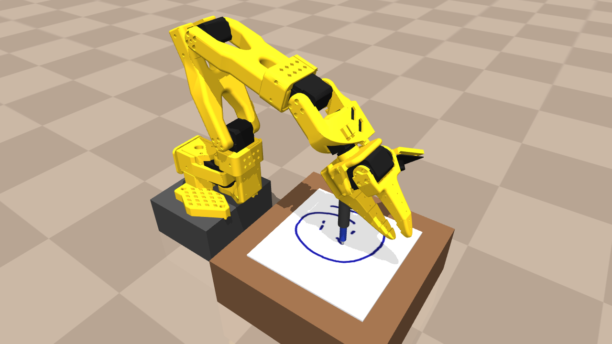
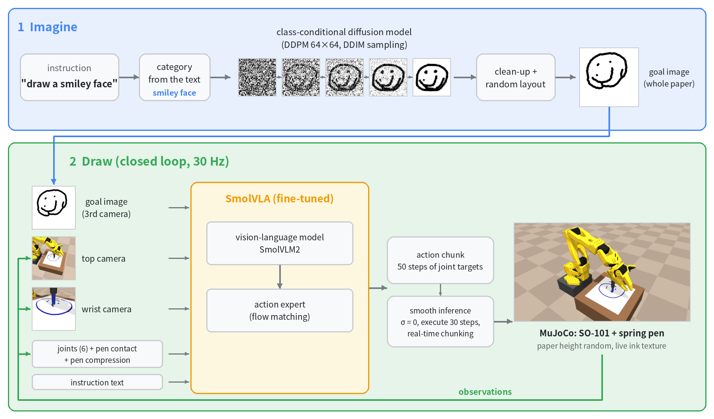
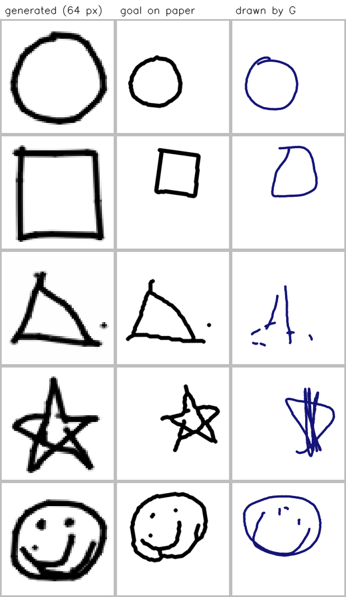
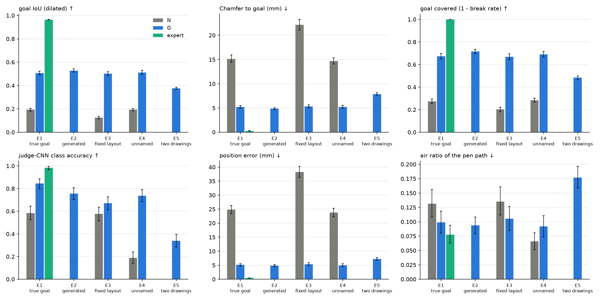

# お絵かきVLA (Oekaki VLA) — imagine a picture, then draw it with a robot

[日本語版 README](README.ja.md)



A simulated SO-101 arm with a **spring-loaded pen** draws pictures on paper from a language instruction such as
`"draw a star"`. A small diffusion model first *imagines* a line drawing. The drawing is placed on the paper
and shown to **SmolVLA** as a goal image (a third camera). SmolVLA then copies the drawing with the pen.

Everything runs in MuJoCo. This is a course final project for Physical AI 応用編 1, 2026.



1. **Imagine.** The category is read from the instruction. A class-conditional diffusion model draws a 64×64
   line drawing, which is cleaned up and placed at a random position, size and angle on the paper: the goal image.
2. **Draw.** At 30 Hz, SmolVLA takes the goal image, the top and wrist cameras, the joint angles with the pen
   contact and compression, and the instruction. It predicts a 50-step chunk of joint targets, executed with
   smooth inference (σ = 0, 30 steps per chunk, real-time chunking).

## Highlights

**A goal image makes the VLA draw what was asked, where it was asked.**
- Setup: two SmolVLA models trained on the same data with the same recipe.
  - **G** sees the goal image.
  - **N** sees only the instruction.
- Test: held-out Quick, Draw! drawings, 250 paired episodes per setting.

| setting | G (goal image) | N (text only) |
|---|---|---|
| goal IoU, true goal | **0.51** | 0.19 |
| position error, true goal | **5.1 mm** | 24.9 mm |
| goal IoU, goal imagined by the diffusion model | **0.53** | — |
| goal IoU, instruction without the category name | **0.51** | 0.19 |

- G is better in 96 % of the paired episodes (Wilcoxon p < 1e-40).
- G is as good without the category name, so it reads *what* to draw from the image.
- The generator never produced an empty image in 1000 samples. The judge CNN recognises 99.9 % of its drawings.

**Smooth drawing from a flow-matching VLA.**
- Out of the box, SmolVLA's arm shakes and the lines are jagged.
- The fix:
  - zero initial flow noise;
  - a long execution horizon (30 of the 50 chunk steps);
  - real-time chunking across the chunk seams.
- Result: quality success rises from 2 % to 54 %, and jerk falls about 160-fold.

**A negative result on touch.** Adding the pen-contact state to the joint state did not change the success
rate significantly (82 % vs 76 %, McNemar p = 0.63). The wrist camera already shows the pen being pushed in.

## Contents
- [Setup](#setup)
- [Models and data on Hugging Face](#models-and-data-on-hugging-face)
- [Repository layout](#repository-layout)
- [Simulation, expert and data](#simulation-expert-and-data)
- [Imagine, then draw (goal images)](#imagine-then-draw-goal-images)
- [Smooth drawing](#smooth-drawing)
- [Does touch help? (A/B)](#does-touch-help-ab)
- [Running on a cloud GPU](#running-on-a-cloud-gpu)
- [License and credits](#license-and-credits)

## Setup

```bash
uv venv --python 3.12 && uv sync                       # lerobot[smolvla] 0.6.1, mujoco 3.x, torch
export MUJOCO_GL=egl                                   # headless GPU rendering
env -u PYTHONPATH .venv/bin/python -m pytest -q tests  # unset PYTHONPATH if a ROS environment sets it
```

- The repository holds no datasets, checkpoints or weights. Scripts write them to `data/` and `outputs/`.
  The trained models and the main dataset are on the Hugging Face Hub (next section).
- Seeds are fixed in `configs/`.

## Models and data on Hugging Face

| | repository | contents |
|---|---|---|
| model | [tkb77/smolvla-oekaki-goal](https://huggingface.co/tkb77/smolvla-oekaki-goal) | SmolVLA model G (sees the goal image) |
| model | [tkb77/oekaki-sketch-diffusion](https://huggingface.co/tkb77/oekaki-sketch-diffusion) | the line-drawing diffusion model |
| dataset | [tkb77/oekaki-goal-v1](https://huggingface.co/datasets/tkb77/oekaki-goal-v1) | dataset goal_v1: 999 expert episodes, LeRobot v3.0 |

`--policy` and `--generator` also take a Hub repository id; the files are downloaded on first use. To draw
without training anything:

```bash
.venv/bin/python scripts/imagine_and_draw.py --prompt "draw a star" --seed 1 --out outputs/demo_star \
    --policy tkb77/smolvla-oekaki-goal --generator tkb77/oekaki-sketch-diffusion
```

The cards are in `docs/hub/`; `scripts/upload_to_hub.py` uploads the models and the dataset with them.

## Repository layout

```
oekaki/env/          scene builder (MjSpec) and DrawingEnv: spring pen, contact switch, live ink texture
oekaki/expert/       IK, contact-driven expert (estimates the paper height from pen compression)
oekaki/data/         expert rollouts -> LeRobotDataset; goal-image episodes (layout, goal image, pairs)
oekaki/render.py     the common line renderer (generator data, goal images, evaluation)
oekaki/quickdraw/    Quick, Draw! download, filter, train / test split
oekaki/layout.py     random placement of a drawing on the paper
oekaki/generator/    class-conditional DDPM: model, sampling, clean-up, "imagine" API
oekaki/classifier/   judge CNN
oekaki/policy/       SmolVLA extensions: training-time RTC, elapsed-time input, Hermite head
oekaki/eval/         metrics (goal IoU, Chamfer, jerk, ...) and policy wrappers (RTC inference)
configs/             env, data generation, training and evaluation configs
scripts/             data generation, training, evaluation, reports, videos, demos (see below)
docker/              training / evaluation image for cloud GPU nodes
docs/                cloud training notes (Japanese), README images, Hugging Face cards
results/goal/        check images and tables of the goal-image experiments
third_party/         reference copy of the adapted generator code (Apache-2.0)
assets/so101/        SO-101 model from MuJoCo Menagerie (Apache-2.0)
```

## Simulation, expert and data

- **Robot.** MuJoCo Menagerie SO-101 (5 DoF + gripper).
  - A pen holder is mounted at 42° on the gripper, so the pen can stand vertically over the whole 15 cm paper.
  - The pen slides in the holder (0–10 mm travel, 300 N/m spring).
  - `contact = compression > 0.5 mm`; the compression is also observed.
- **Paper.** Its height is random in every episode (±20 mm), and the paper sometimes moves while the robot draws.
- **Ink.** A 512×512 texture is updated from the tip–paper contacts every physics substep. The drawn lines
  therefore appear in the camera images.
- **Cameras.** Overhead and wrist, 256 px.
- **Expert.** It never reads the true paper height.
  - It estimates the height from the pen compression.
  - It advances along a stroke only while in contact, and searches downward when contact is lost.
  - A dot is a tap.
  - DART-style height noise is added to the executed action; the clean action is recorded.

## Imagine, then draw (goal images)

### How it works

| piece | files | notes |
|---|---|---|
| common renderer | `oekaki/render.py` | One function draws every line image (line width = size / 32, dots as discs). Generated images and robot canvases are restyled through a skeleton. |
| Quick, Draw! | `scripts/download_quickdraw.py`, `configs/quickdraw.yaml` | circle, square, triangle, star, smiley face. Recognized drawings with ≤ 8 strokes. The test split (by `key_id`) is used only for evaluation. |
| layout | `oekaki/layout.py`, `configs/layout.yaml` | Random size (40–90 % of the drawable area), rotation (±15°) and mirroring. One affine transform moves both the expert strokes and the goal image. |
| dataset goal_v1 | `scripts/generate_goal_dataset.py`, `configs/datagen_goal_v1.yaml` | 999 episodes, 421k frames. `observation.images.goal` is a third video stream. 30 % of the instructions do not name the category. |
| generator | `scripts/train_generator.py`, `configs/generator.yaml` | DDPM, 5.0 M parameters, classifier-free guidance, EMA, DDIM with intermediate images. Adapted from lcccluck/sketch-model (see NOTICE). |
| judge CNN | `scripts/train_classifier.py` | 5-way classifier; 99.1 % test accuracy. |
| SmolVLA G / N | `configs/train_goal_{G,N}.yaml`, `scripts/train_smolvla.py` | 15k steps, effective batch 64, training-time RTC and elapsed time. N excludes the goal camera. |
| pre-check | `configs/train_goal_overfit_G.yaml`, `scripts/eval_goal_overfit.py` | G overfit on 30 episodes, then evaluated with its own goals and with swapped goals. |
| evaluation | `scripts/evaluate_goal.py`, `configs/eval_goal.yaml`, `scripts/report_goal.py` | Settings E1–E5 with bootstrap CIs, image grids and a failure breakdown. |
| demo | `scripts/imagine_and_draw.py` | Instruction → diffusion animation → robot drawing → goal vs result video. |
| README figures | `scripts/make_readme_figures.py` | The photo and the system diagram above, from one real episode of model G. |

```bash
.venv/bin/python scripts/download_quickdraw.py                  # data + contact sheets
.venv/bin/python scripts/generate_goal_dataset.py               # dataset goal_v1 -> data/goal_v1/G
bash scripts/goal_pipeline.sh classifier                       # judge CNN
bash scripts/goal_pipeline.sh generator                        # diffusion model
bash scripts/goal_pipeline.sh G; bash scripts/goal_pipeline.sh N
.venv/bin/python scripts/evaluate_goal.py --agent G=outputs/train/goal_G/checkpoints/last \
    --agent N=outputs/train/goal_N/checkpoints/last --agent expert=expert --settings E1 E2 E3 E4 E5
.venv/bin/python scripts/report_goal.py                         # -> results/goal/eval
.venv/bin/python scripts/imagine_and_draw.py --prompt "draw a star" --seed 1 --out outputs/demo_star
```

### Examples



### Results
Setup:
- 50 episodes per category and setting (250 per setting).
- Goals come from the held-out test split.
- G, N and the expert run the same episodes.
- Inference: σ = 0, replan every 30 steps, latency 3, inference-time RTC.
- Brackets are bootstrap 95 % CIs. Full tables: `results/goal/eval/`.

| setting | model | goal IoU ↑ | position error (mm) ↓ | judge-CNN accuracy ↑ |
|---|---|---|---|---|
| E1 true goal | G | **0.51** [0.49, 0.52] | **5.1** | **0.84** |
| E1 true goal | N | 0.19 [0.18, 0.21] | 24.9 | 0.58 |
| E1 true goal | expert | 0.97 | 0.5 | 0.98 |
| E2 generated goal | G | 0.53 [0.52, 0.54] | 4.8 | 0.76 |
| E3 fixed layouts | G / N | 0.50 / 0.13 | 5.4 / 38.3 | 0.67 / 0.58 |
| E4 no category name | G / N | 0.51 / 0.19 | 5.0 / 23.8 | 0.74 / 0.19 |
| E5 two drawings side by side | G | 0.38 | 7.2 | — |



- **Pre-check.** G trained on 30 episodes copies its own goals (IoU 0.60) but not swapped ones (0.21). With
  949 episodes it generalises to unseen test goals.
- **Failures** are mostly broken shapes: thin star tips, smiley eyes, and goals far from the typical form of
  their category.
- **E5.** Two drawings get merged into one shape; the training data had one drawing per image.

### Follow-up: more data and two-drawing episodes
- Dataset goal_v2 (`configs/datagen_goal_v2.yaml`) has 2000 single-drawing and 500 two-drawing episodes.
- Same recipe as G, except for the data or the number of steps. Differences are paired with G on the same episodes (Wilcoxon).

| model | training data | E1 IoU | E2 IoU | E5 IoU |
|---|---|---|---|---|
| G | goal_v1, 999 single | 0.507 | 0.528 | 0.376 |
| G_2x | goal_v2, 1997 single | **0.530** (p = 0.007) | **0.551** (p = 0.002) | 0.383 |
| G_pair | goal_v2, 1000 single + 496 pairs | 0.500 (n.s.) | 0.509 | **0.523** (p < 1e-34) |
| G_long | goal_v1, 999 single, 30k steps | **0.561** (p < 1e-10) | **0.580** (p < 1e-11) | 0.390 |

- Training twice as long helps the shape detail most (+0.05 IoU). Twice the data gives +0.02. Both gains are significant.
- With two-drawing episodes the robot learns to draw two separate shapes at the two places. E5 IoU rises to
  the single-drawing level.
- But the shape in each half is no more often correct. The judge CNN on the left and right halves gives:

  | model | halves correct |
  |---|---|
  | G | 0.33 |
  | G_2x | 0.39 |
  | G_long | 0.39 |
  | G_pair | 0.31 |

  See `results/goal/eval/e5_halves.md` and `e5_G_vs_G_pair.png`.

## Smooth drawing

- **Model.** Condition A data, 10k steps.
- **Training-time extensions** (`oekaki/policy/smolvla_plus.py`, `configs/train_smooth_*.yaml`):
  - training-time RTC: per-token flow time and a clean prefix of d ≤ 6 actions;
  - a Hermite-curve auxiliary head;
  - an elapsed-time input.
- **Inference schemes** (`oekaki/eval/policy.py`): temporal ensembling, chunking, inference-time RTC and
  TT-RTC. All run with a simulated latency and a configurable initial noise σ.

| model / inference | quality std | quality dist | Chamfer std (mm) | jerk std |
|---|---|---|---|---|
| expert | 1.00 | 1.00 | 0.65 | 3.7k |
| plain: chunking σ=1, replan 5 | 0.02 | 0.02 | 4.92 | 642k |
| temporal ensembling σ=1 | 0.12 | 0.10 | 3.72 | 138k |
| σ=0, replan 30, latency 3, inference-time RTC | 0.50 | 0.24 | 2.42 | 3.9k |
| + training-time RTC + elapsed time (final) | **0.54** | 0.28 | **2.25** | 4.1k |
| + Hermite auxiliary loss λ=10 | 0.24 | 0.12 | 3.22 | 5.1k |

Quality success = recognised ∧ less than 10 % in the air ∧ ink 0.6–1.4× the expert's ∧ Chamfer ≤ 2 mm.
Each run has 50 standard and 50 disturbed episodes.

1. **The wobble is sampling noise inside each chunk, not the chunk seams.** The jerk of the predicted chunks
   drops from 516k to 1.7k when σ goes from 1 to 0.
2. **With σ=0, a long execution horizon helps.** Quality rises from 0.18 with replan 5 to 0.48 with replan 30.
3. **RTC removes the seam jumps** under 3 steps of latency.
4. **The training-time extensions add little.** The final model scores 0.41 against 0.37 for the same model
   with inference-time RTC only (p = 0.42).

Commands: `scripts/run_smooth_eval.sh`, `scripts/report_smooth.py`, `scripts/render_smooth_videos.sh`.

## Does touch help? (A/B)

| condition | `observation.state` |
|---|---|
| **A** | 6 joint angles + contact flag + pen compression (8-D) |
| **B** | 6 joint angles (6-D) |

- Data: 500 expert episodes, 162k frames.
- Training: 20k steps per condition.
- Evaluation: paired episodes; success = CLIP recognises the shape ∧ less than 10 % of the path in the air.

| condition | n | A | B | expert | A vs B (McNemar) |
|---|---|---|---|---|---|
| standard | 50 | 0.82 | 0.76 | 1.00 | p = 0.63 |
| paper moves while drawing | 50 | 0.56 | 0.54 | 0.96 | p = 1.00 |
| paper height outside the training range (paper visible) | 14 | 0.79 | 0.57 | 1.00 | p = 0.38 |

- A loses contact less often in standard episodes (air ratio 0.029 vs 0.062, p = 0.04).
- No success difference is significant. The wrist camera shows the pen being pushed in, so B can read
  contact from the image.

```bash
.venv/bin/python scripts/test_pen_spring.py                  # spring pen checks
.venv/bin/python scripts/validate_expert.py --n 15           # expert check
.venv/bin/python scripts/generate_dataset.py --name touch    # data/touch/{A,B}
bash scripts/train.sh                                        # SmolVLA A then B
.venv/bin/python scripts/evaluate.py --agent A=outputs/train/A/checkpoints/last \
    --agent B=outputs/train/B/checkpoints/last --agent expert=expert --episodes-per-shape 10
.venv/bin/python scripts/make_report.py --eval artifacts/eval/results_A_B_expert.json
```

## Running on a cloud GPU

The goal-image training and evaluation ran on an AWS g6e.24xlarge (4× NVIDIA L40S), one run per GPU:

| run | time |
|---|---|
| generator + judge | 4.0 h |
| G | 3.9 h |
| N | 2.7 h |
| 2000 evaluation episodes, 25 processes | 31 min |

- `docker/Dockerfile.train` builds the environment: torch for CUDA 12.8, FFmpeg, EGL for MuJoCo, AWS CLI and
  the SmolVLA base weights.
- `scripts/cloud_task.sh` (training) and `scripts/cloud_eval_goal.sh` (sharded evaluation) fetch the code and
  data from object storage. They sync the results back every 10–15 minutes.
- Details: `docs/cloud_training.md` (Japanese).

## License and credits

The code of this repository is licensed under the [Apache License 2.0](LICENSE); see [NOTICE](NOTICE).

| what | source | license | how it is used |
|---|---|---|---|
| SO-101 model | MuJoCo Menagerie `robotstudio_so101` | Apache-2.0, `assets/so101/LICENSE` | bundled |
| diffusion model code | [lcccluck/sketch-model](https://huggingface.co/lcccluck/sketch-model) | Apache-2.0 | adapted; weights trained from scratch |
| drawings | [Quick, Draw! dataset](https://github.com/googlecreativelab/quickdraw-dataset), Google Creative Lab | CC BY 4.0 | downloaded, not redistributed |
| VLA | SmolVLA / LeRobot, Hugging Face | Apache-2.0 | base model and training stack |
| simulator | MuJoCo | Apache-2.0 | simulation |

The implementation, the experiments and the documents were made with the help of an AI coding assistant
(Claude).
